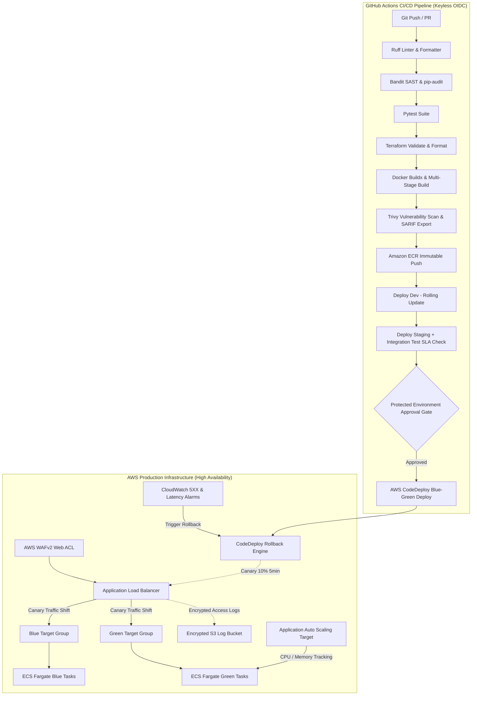

# Enterprise Zero-Downtime CI/CD Pipeline for AWS ECS Fargate
### Blue-Green Canary Deployments, Automated Rollbacks, WAFv2, Auto-Scaling & DevSecOps

A production-grade CI/CD and cloud infrastructure platform on AWS built with **GitHub Actions**, **Terraform**, **AWS ECS Fargate**, and **AWS CodeDeploy**. Pushes to `main` flow through automated SAST/dependency audits, container vulnerability scans, automated dev/staging deployments, integration smoke tests with latency SLA verification, a manual approval gate, and zero-downtime blue-green canary deployments to production with automated rollback on 5XX errors or P95 latency degradation.

---

## 1. Enterprise Architecture



---

## 2. Production Engineering Highlights

### 🛡️ DevSecOps & Security Hardening
- **AWS WAFv2 Web ACL**: Protects the public Application Load Balancer with `AWSManagedRulesCommonRuleSet`, `AWSManagedRulesKnownBadInputsRuleSet`, `AWSManagedRulesAmazonIpReputationList`, and IP rate limiting (2,000 req/5 min).
- **Encrypted ALB Access Logs**: Dedicated S3 bucket with TLS-only bucket policy, SSE-AES256 encryption, public access blocks, and 90-day lifecycle expiration.
- **Keyless AWS OIDC Federation**: No static, long-lived AWS IAM access keys stored in GitHub Secrets. Ephemeral tokens via STS AssumeRoleWithWebIdentity.
- **Multi-Stage Hardened Docker Packaging**: Two-stage build isolating compilation tools, executing as non-root user (`appuser:appgroup`), with explicit `STOPSIGNAL SIGTERM`.
- **Pre-deployment SAST & Supply-Chain Audits**: Bandit static analysis and `pip-audit` scanning run directly in the CI quality gate alongside Trivy SARIF container vulnerability reports.
- **KMS ECR Encryption & Tag Immutability**: Container images are cryptographically encrypted at rest and tag overwrites are forbidden.

### ⚡ Reliability, Resilience & Traffic Management
- **Zero-Downtime Blue-Green Canary Rollouts**: CodeDeploy shifts traffic progressively (`ECSCanary10Percent5Minutes`) to validate production workloads on the green task set.
- **Multi-Metric Automated Rollback**: CodeDeploy automatically cancels the traffic shift and restores the blue task set if either HTTP 5XX error rates exceed threshold OR P95 Target Response Time exceeds 1.0s.
- **Graceful Shutdown & Connection Draining**: Application intercepts `SIGTERM` signals, flips readiness to 503 (`/readyz`), and allows ALB connection draining and in-flight HTTP requests to complete within a 30s `stopTimeout`.
- **Target Tracking Application Auto Scaling**: Dynamic Fargate task scaling between min 2 and max 10 instances based on CPU utilization (70%) and Memory utilization (80%).
- **Multi-AZ NAT Gateway Architecture**: Configurable toggle (`enable_multi_az_nat`) to deploy dedicated NAT Gateways across each Availability Zone to prevent single-point-of-failure network outages.

### 📊 Observability & SRE Operations
- **Prometheus Telemetry Exposition**: Application exposes native `/metrics` endpoint with request counters, latency histograms, and Python runtime metrics.
- **Structured JSON CloudWatch Logging**: Application stdout logs in structured JSON format with unique `X-Request-ID` propagation for distributed tracing.
- **CloudWatch Operational Dashboard**: Real-time unified dashboard monitoring Blue vs Green target group traffic shifts, 4XX/5XX rates, P50/P95/P99 latencies, and ECS task CPU/Memory.
- **Comprehensive Operations Runbook**: Documented incident triage, break-glass manual rollback steps, and CloudWatch Logs Insights diagnostic queries in [`docs/OPERATIONS_RUNBOOK.md`](docs/OPERATIONS_RUNBOOK.md).

---

## 3. Repository Structure

```
├── .github/
│   └── workflows/
│       └── pipeline.yml         # CI/CD: lint -> SAST -> test -> build/scan -> dev -> staging -> prod
├── .dockerignore                # Production Docker context exclusion rules
├── app/
│   ├── app.py                   # Flask app: /livez, /readyz, /health, /metrics, SIGTERM handling
│   ├── gunicorn.conf.py         # Production Gunicorn config: keepalive, worker recycling, timeouts
│   ├── Dockerfile               # Multi-stage Docker packaging running as non-root user
│   ├── requirements.txt         # Dependencies: Flask, Gunicorn, Prometheus-Client
│   └── tests/
│       ├── test_app.py          # Pytest unit tests (liveness, readiness, metrics, security headers)
│       └── integration_test.py  # Smoke tests: latency SLA thresholding, probe verification, retries
├── appspec.yaml                 # AWS CodeDeploy AppSpec for ECS Blue-Green deployments
├── docs/
│   └── OPERATIONS_RUNBOOK.md    # SRE incident triage, rollback procedures, Logs Insights queries
└── terraform/
    ├── alb.tf                   # Prod ALB + Blue/Green Target Groups + Access Logging
    ├── autoscaling.tf           # Application Auto Scaling target & Target Tracking policies
    ├── cloudwatch.tf            # Metric Alarms: 5XX count & TargetResponseTime latency
    ├── codedeploy.tf            # CodeDeploy app, deployment group, and rollback triggers
    ├── dashboard.tf             # CloudWatch operational dashboard
    ├── ecr.tf                   # ECR repository with KMS encryption, scan-on-push, lifecycle policy
    ├── ecs.tf                   # ECS Cluster + Prod Fargate Service with stopTimeout & healthCheck
    ├── ecs_nonprod.tf           # Dev and Staging ALBs, target groups, and services
    ├── iam.tf                   # ECS Execution/Task roles, CodeDeploy role, OIDC Deploy role
    ├── locals.tf                # Shared tags and metadata
    ├── network.tf               # VPC, subnets, IGW, Multi-AZ NAT Gateways, route tables
    ├── outputs.tf               # Infrastructure outputs (ALB DNS, WAF ARN, Dashboard, Logs Bucket)
    ├── providers.tf             # AWS Provider & remote S3 backend
    ├── security_groups.tf       # Least-privilege ingress/egress security groups
    ├── ssm.tf                   # AWS Systems Manager Parameter Store & IAM read policy
    ├── s3_alb_logs.tf           # Encrypted S3 bucket for ALB access logging
    ├── variables.tf             # Parameterized variables with validation constraints
    ├── terraform.tfvars.staging # Staging environment configuration
    └── terraform.tfvars.production # Production environment configuration (Multi-AZ HA)
```

---

## 4. Setup & Deployment Guide

### Prerequisites
- AWS CLI configured locally with administrative permissions.
- Terraform >= 1.6.0.
- GitHub repository with GitHub Actions enabled.

### 1. Provision Infrastructure with Terraform
```bash
cd terraform

# Select environment profile (e.g. production)
cp terraform.tfvars.production terraform.tfvars

# Initialize Terraform with your S3 backend
terraform init \
  -backend-config="bucket=<your-state-bucket>" \
  -backend-config="key=cicd-demo/terraform.tfstate" \
  -backend-config="region=us-east-1"

# Plan and Apply
terraform plan
terraform apply
```

### 2. Configure GitHub Repository
1. **GitHub Secrets** (`Settings` -> `Secrets and variables` -> `Actions`):
   - `AWS_GITHUB_OIDC_ROLE_ARN`: Value from `terraform output github_deploy_role_arn`.
   - `STAGING_ALB_DNS`: Value from `terraform output staging_alb_dns_name`.
2. **GitHub Environments** (`Settings` -> `Environments`):
   - Create `dev`, `staging`, and `production`.
   - On `production`, enable **Required reviewers** to activate the deployment approval gate.

### 3. Deploy
Push your code or merge a Pull Request to `main`. The pipeline automatically executes all test gates, builds and scans the container image, deploys to `dev` and `staging`, and waits for manual approval before executing the zero-downtime blue-green canary deployment to `production`.

---

## 5. Senior DevOps / Cloud Architect Resume Bullets

- **Architected and implemented an enterprise zero-downtime CI/CD deployment engine** on AWS using GitHub Actions, Terraform, and AWS ECS Fargate, reducing deployment lead time and eliminating production downtime.
- **Engineered automated blue-green canary deployments** with AWS CodeDeploy, implementing dual-metric automated rollbacks triggered by CloudWatch HTTP 5XX spikes and P95 latency SLA breaches (> 1.0s).
- **Hardened production infrastructure and perimeter security** by deploying AWS WAFv2 with AWS Managed Rules and rate limiting, encrypted S3 ALB access logging, KMS-encrypted immutable ECR repositories, and keyless GitHub Actions authentication via AWS IAM OIDC federation.
- **Implemented cloud-native application resiliency** in Python/Flask with distinct `/livez` and `/readyz` probes, graceful `SIGTERM` connection draining, and Gunicorn lifecycle tuning (`keepalive=65s`, worker recycling).
- **Configured Target Tracking Application Auto Scaling** on ECS Fargate (CPU at 70%, Memory at 80%) and built Multi-AZ NAT Gateway failover architecture to ensure high availability across Availability Zones.
- **Streamlined DevSecOps compliance** by integrating Bandit SAST, `pip-audit` supply-chain scanning, and Trivy container vulnerability audits with native SARIF reporting into GitHub Security.
