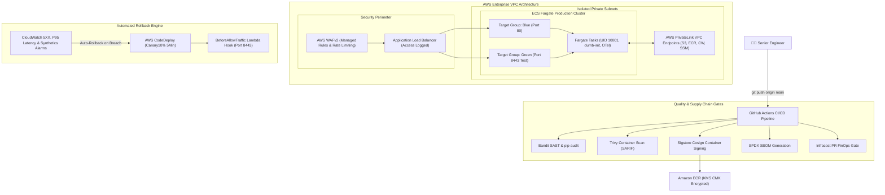

# Production AWS ECS Blue/Green CI/CD Pipeline (Enterprise v2.0)

[](https://github.com/MelvinjoseC/Aws-cicd-bluegreen-pipeline/actions/workflows/pipeline.yml)
[](https://www.terraform.io/)
[](https://aws.amazon.com/fargate/)
[](https://www.docker.com/)
[](https://aquasecurity.github.io/trivy/)
[](https://sigstore.dev/)

Enterprise-grade, zero-downtime Blue/Green continuous deployment platform on **AWS ECS Fargate**, orchestrated by **AWS CodeDeploy** and **GitHub Actions**, with **AWS WAFv2**, **PrivateLink VPC Endpoints**, **KMS CMK**, **OpenTelemetry distributed tracing**, and automated CloudWatch latency rollback alarms.

---

## Architecture Overview



---

## Key Enterprise Highlights

1. **Zero-Downtime Blue/Green Traffic Shifting**:
   - `CodeDeployDefault.ECSCanary10Percent5Minutes` automatically shifts 10% of user traffic for 5 minutes.
   - Dedicated Test Listener on port 8443 validates the Green fleet before user traffic shifting commences.
   - Automatic instant rollback on ALB 5XX spikes, P95 latency > 200ms, or synthetic canary failures.

2. **Supply Chain Security & DevSecOps**:
   - **Keyless Signing**: Images cryptographically signed with Sigstore Cosign via GitHub OIDC.
   - **SBOM Publishing**: Automated generation of SPDX Software Bill of Materials via Syft.
   - **Multi-Layer Scanning**: Ruff linting, Bandit SAST, pip-audit CVE analysis, and Trivy container vulnerability gating.

3. **Cloud Networking & FinOps Optimization**:
   - **AWS PrivateLink Endpoints**: Interface endpoints for ECR, CloudWatch, and SSM keep internal traffic off the internet and eliminate NAT Gateway bandwidth fees.
   - **KMS Customer Managed Key**: Envelope encryption across Secrets Manager, CloudWatch Logs, and ECR with 365-day rotation.
   - **FinOps Alerts**: AWS Budgets monitoring monthly infrastructure burn rate.

4. **Production Observability & Resilience**:
   - **OpenTelemetry & X-Ray**: Distributed trace ID propagation across all HTTP boundaries.
   - **In-Memory Rate Limiting**: Token-bucket protection preventing task thread exhaustion.
   - **Circuit Breaker**: Resilient HTTP client with exponential backoff and decorrelated jitter.
   - **Health Probes**: Discrete `/livez`, `/readyz`, `/health`, and `/health/diagnostic` endpoints.

---

## Repository Structure

```text
├── .github/
│   ├── dependabot.yml            # Automated dependency updates for Actions, Pip, Docker, TF
│   └── workflows/
│       ├── pipeline.yml          # Core multi-stage CI/CD pipeline
│       ├── cosign-attestation.yml# Sigstore Cosign keyless signing
│       ├── sbom.yml              # SPDX SBOM generation
│       └── infracost.yml         # FinOps infrastructure cost estimation
├── app/
│   ├── app.py                    # Hardened Flask microservice with OTel & rate limiting
│   ├── config.py                 # Strict schema configuration validation
│   ├── rate_limiter.py           # Thread-safe token bucket rate limiter
│   ├── utils/http_client.py      # Resilient egress client with circuit breaker & jitter
│   ├── tests/                    # Unit, contract, and integration test suite
│   ├── Dockerfile                # Multi-stage build with dumb-init & UID 10001
│   └── gunicorn.conf.py          # Production WSGI server configuration
├── docs/
│   ├── adr/                      # Architecture Decision Records (ADR 001 - 005)
│   ├── openapi.yaml              # OpenAPI 3.1 contract specification
│   ├── SLO_FRAMEWORK.md          # 99.95% SLO and Error Budget burn rate policy
│   ├── DISASTER_RECOVERY.md      # Multi-Region DR Playbook (RTO < 15m, RPO < 1m)
│   ├── SECURITY_THREAT_MODEL.md  # Comprehensive STRIDE threat analysis
│   └── OPERATIONS_RUNBOOK.md     # Production operational runbook
├── scripts/
│   └── before_allow_traffic.py   # CodeDeploy BeforeAllowTraffic validation hook
├── tests/
│   ├── locustfile.py             # Locust distributed load & canary stress test
│   └── chaos_test.py             # Chaos engineering task termination experiment
├── terraform/                    # Modular Terraform IaC (VPC, ECS, ALB, WAF, KMS, etc.)
└── Makefile                      # Unified developer CLI toolkit
```

---

## Quick Start (Local Development)

```bash
# Display developer CLI commands
make help

# Run linting and static analysis
make lint

# Run full unit and contract test suite
make test

# Build and run production container locally
make docker-build
make docker-run
```

---

## Production Deployment Workflow

1. Push to `main` initiates GitHub Actions CI gates (Ruff, Bandit, pip-audit, Pytest, Terraform fmt/validate).
2. Docker buildx compiles and caches multi-arch container image.
3. Trivy scans image for CRITICAL/HIGH vulnerabilities, uploading SARIF report to GitHub Security.
4. Image pushed to ECR and signed with Sigstore Cosign; SPDX SBOM generated.
5. Deploys to `dev` environment via rolling update.
6. Deploys to `staging` environment and runs synthetic integration tests.
7. Deploys to `production` via AWS CodeDeploy Canary (10% over 5 minutes) with automatic CloudWatch metric rollback triggers.
