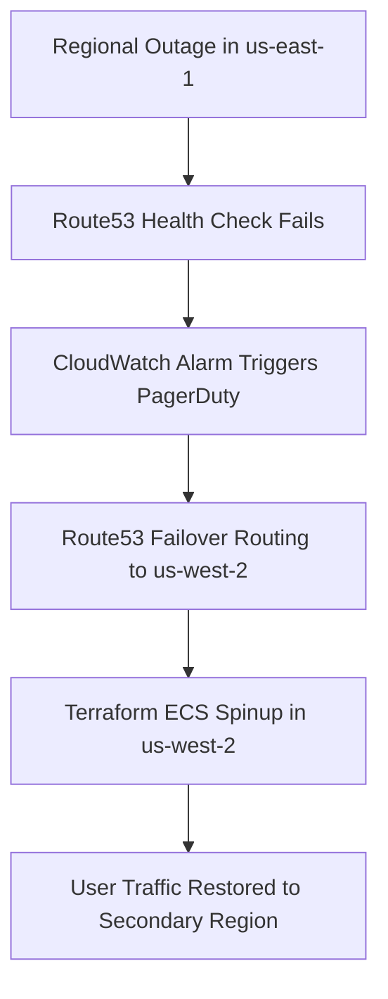

# Production Disaster Recovery (DR) & Business Continuity Playbook

## 1. Targets & Classification
- **Recovery Time Objective (RTO)**: < 15 Minutes
- **Recovery Point Objective (RPO)**: < 1 Minute (Stateless microservices / ECR replication)
- **Disaster Classification Tier**: Tier 1 Mission-Critical

## 2. Multi-Region Architecture
- **Primary Region**: `us-east-1` (Active)
- **Secondary Region**: `us-west-2` (Warm Standby / IaC Ready)

## 3. Failover Procedures



### Step 1: Declare Incident & Activate DR Team
1. Verify regional impairment via AWS Health Dashboard and CloudWatch Synthetics.
2. Convene incident bridge on Slack (`#incident-room-sev1`).

### Step 2: Route53 DNS Failover
If Route53 failover routing policy has not automatically switched:
```bash
aws route53 change-resource-record-sets \
  --hosted-zone-id Z123456789 \
  --change-batch file://dr/route53-failover-dr.json
```

### Step 3: Validate Standby Infrastructure
1. Run smoke tests against secondary ALB:
   ```bash
   python app/tests/integration_test.py "http://${SECONDARY_ALB_DNS}"
   ```
2. Verify ECR cross-region image sync and task health.
