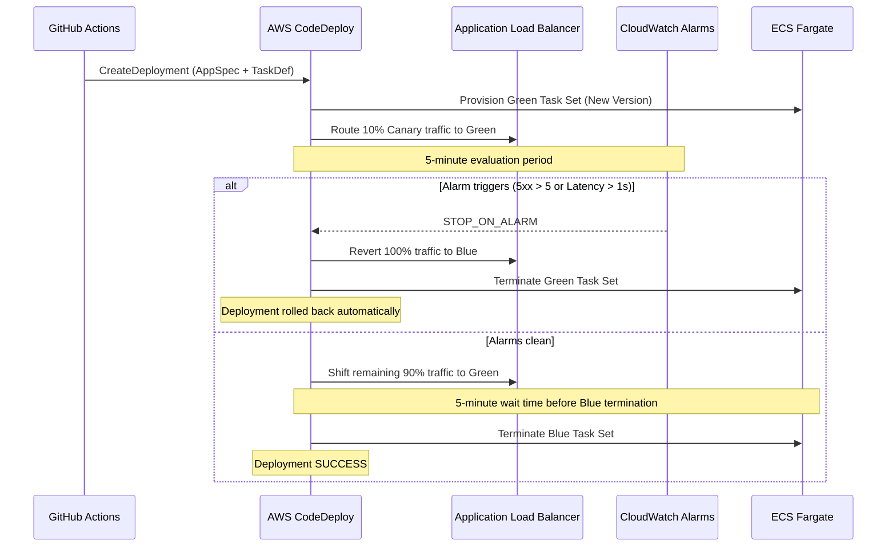

# Production Operations & Incident Rollback Runbook

This runbook defines operational procedures, incident response workflows, and rollback protocols for the **AWS ECS Blue-Green CI/CD Pipeline**.

---

## 1. System Architecture Overview

- **Compute**: AWS ECS Fargate Cluster (`cicd-demo-cluster`)
- **Traffic Routing**: Application Load Balancer with Blue/Green Target Groups
- **Deployment Engine**: AWS CodeDeploy (`CodeDeployDefault.ECSCanary10Percent5Minutes`)
- **Rollback Triggers**: Dual-target CloudWatch Metric Alarms (HTTP 5xx rate > 5 in 2 min, Target Response Time p95 > 1.0s)
- **Security Perimeter**: AWS WAFv2 Web ACL + S3 Encrypted Access Logs + IAM Least Privilege Roles

---

## 2. Blue-Green Deployment Lifecycle



---

## 3. Incident Severity Matrix & Triage

| Severity | Condition | Immediate Action |
|---|---|---|
| **SEV-1 (Critical)** | CodeDeploy deployment in progress; production 5XX error rate > 5% or user outages. | Automated rollback should fire. If not, trigger **Emergency Manual Rollback** immediately. |
| **SEV-2 (High)** | Latency alarm (`prod-latency-*`) breached; p95 > 1.0s. | Check CloudWatch Dashboard, inspect worker thread utilization, verify DB connection pool. |
| **SEV-3 (Medium)** | WAF rate-limiting false positive or intermittent health check failure on dev/staging. | Review WAF sampled requests, inspect `/readyz` error output. |

---

## 4. Emergency Procedures

### 4.1 Manual Deployment Abort & Rollback (Break-Glass)

If an anomaly is detected during canary traffic shifting before an automated alarm triggers:

```bash
# 1. List active deployments
aws codedeploy list-deployments \
  --application-name cicd-demo-codedeploy-app \
  --deployment-group-name cicd-demo-prod-dg \
  --include-only-statuses "InProgress"

# 2. Stop deployment and force immediate rollback to previous Blue task set
aws codedeploy stop-deployment \
  --deployment-id <DEPLOYMENT_ID> \
  --auto-rollback-enabled
```

### 4.2 Verify Traffic Routing Post-Rollback

Confirm that the production ALB listener forwards 100% of traffic to the stable target group:

```bash
aws elbv2 describe-listeners \
  --load-balancer-arn <PROD_ALB_ARN> \
  --query "Listeners[0].DefaultActions[0]"
```

---

## 5. CloudWatch Logs Insights Diagnostic Queries

Run these queries in CloudWatch Logs Insights on `/ecs/cicd-demo-prod`:

### Query 1: Top 50 Error Exceptions
```sql
fields @timestamp, request_id, level, message, exception
| filter level = "ERROR" or ispresent(exception)
| sort @timestamp desc
| limit 50
```

### Query 2: Request Latency & Status Distribution
```sql
fields @timestamp, method, path, status, duration_ms
| filter @message like /Finished/
| stats count(*) as total, avg(duration_ms) as avg_latency, pct(duration_ms, 95) as p95 by path, status
| sort total desc
```

### Query 3: Container Graceful Shutdown Verification
```sql
fields @timestamp, message
| filter message like /termination signal/ or message like /draining/
| sort @timestamp desc
```

---

## 6. SRE Operational Verification Checklist

- [ ] CloudWatch Dashboard `cicd-demo-production-overview` healthy.
- [ ] No unacknowledged alarms in `ALARM` state.
- [ ] Application Auto Scaling target `service/cicd-demo-cluster/cicd-demo-prod` within min=2 max=10 bounds.
- [ ] AWS WAFv2 Web ACL blocking rate limit violators without elevated false-positive rate.
- [ ] S3 access logs accumulating in `${project_name}-alb-access-logs-*` bucket.
